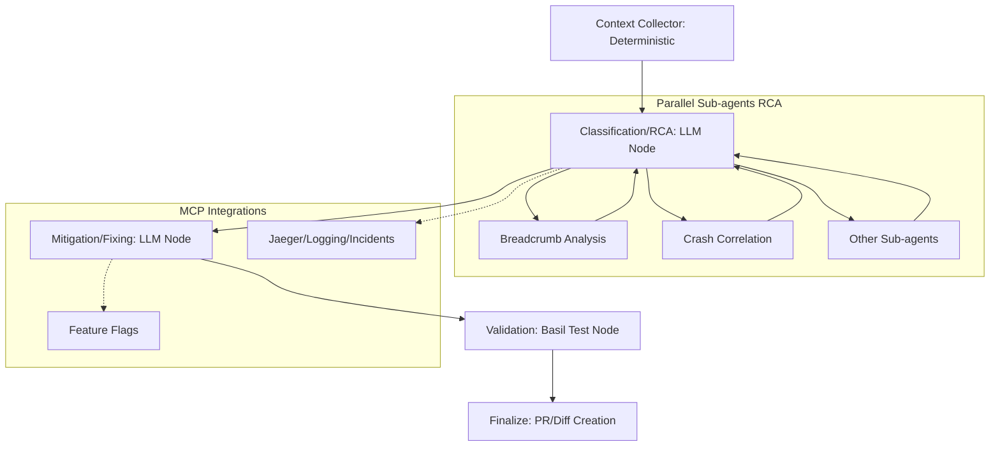
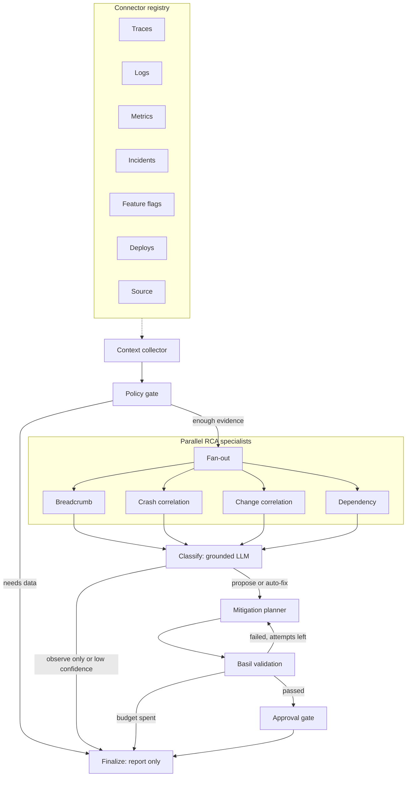

# Architecture

The starting sketch is a straight line:



That sketch has the right stages. It is not yet a system you can extend or trust with a code change. The prototype implements the version below, and the rest of this document is why each change exists.



## What changed

| Sketch | Problem | Enhancement |
| --- | --- | --- |
| Jaeger, logging, and flags are edges into specific nodes | Every new tool becomes a special case inside RCA or mitigation | A connector registry. Nodes ask for a capability. Jaeger, Loki, Prometheus, PagerDuty, LaunchDarkly, Unleash, and GitHub deployments are interchangeable adapters. |
| The collector's output is unspecified | Models end up reading vendor JSON | One evidence schema. Vendor parsers normalize into it before anything else runs. |
| The collector hands raw text to a model | Secrets in logs become training context and prompt injection | Deterministic redaction runs in the collector, before any model call. |
| RCA always continues into a fix | A sev-1 or an empty trace window still produces a patch | A policy gate chooses `needs_data`, `observe_only`, `propose`, or `auto_fix`. Autonomy is code, not a prompt. |
| "Other sub-agents" | No contract, so nobody knows how to add one | A specialist returns hypotheses with fact ids. Registering a class adds a parallel branch. |
| Breadcrumb and crash only | Outages are usually a rollout, and the failing service is often not the broken one | Change correlation and dependency specialists ship beside the original two. |
| One LLM node owns RCA | The model can invent a cause that no specialist found | Specialists extract facts. The classifier may only pick a hypothesis id and cite fact ids that exist. Anything else is discarded. |
| Mitigation is a single LLM step | The first idea is often a flag ramp that does not fix the code | The planner can be wrong. Basil runs in a scratch workspace. A failure comes back as a critique, with a bounded number of attempts. |
| Basil is the validation node | Binding the graph to one product makes the stage impossible to test | Basil is a runner behind a result contract (`basil-result.v1`) shaped like BASIL's tmt context. The default engine is local pytest. `tmt` is an alternate engine. |
| Finalize always opens a PR | Some runs should stop at a report or an escalation | Finalize writes a report always, and a diff plus pull-request body only after approval. The scenario tree is never edited in place. |
| No memory of the run | You cannot explain the patch later | The run directory keeps the report, the diff, the pull-request body, the model transcript, and a state snapshot. |

## Stage contracts

### 1. Context collector

Input is a scenario directory with `incident.json`. The collector builds a `Query` (service, environment, window, symptom) and asks every registered connector. Connectors run concurrently. One connector raising does not drop the others; the error is recorded on the coverage report.

Evidence items look like:

```json
{
  "connector_id": "fixture-traces",
  "capability": "traces",
  "title": "traces from traces.json",
  "body": {"traces": []}
}
```

Capabilities are `traces`, `logs`, `metrics`, `incidents`, `feature_flags`, `deploys`, and `source`. A specialist that understands `traces` works whether the body came from the fixture file or from `parse_jaeger`.

### 2. Policy gate

`debug_agent/policy.py` is the function to edit when your organization disagrees with the defaults:

- No traces and no logs → `needs_data`. Metrics and deploy events alone are not enough.
- Severity 1, once behavioral evidence exists → `observe_only`. Diagnose, do not edit.
- Production, or a sensitive domain such as payments → `propose`.
- Dev, staging, or test → `auto_fix`, and even then only a low-risk validated plan can be marked for unattended apply.

### 3. Parallel specialists and classification

The shipped specialists are:

- **breadcrumb** rebuilds the failing span path.
- **crash_correlation** clusters error logs. It may ask the model for one sentence, and it drops that sentence unless every cited fact id was produced by the cluster step.
- **change_correlation** keeps flag flips and deploys inside the incident window or its lookback.
- **dependency** reports an upstream metric jump as a symptom, not as a cause.

LangGraph sends one branch per specialist and waits for all of them (`add_edge([...], "classify")`) before classification.

The classifier's only job is to choose a `primary_id` from that list and cite fact ids. Confidence stays with the specialist scores. A support hypothesis from another specialist can nudge the score slightly. An unreadable or ungrounded response stops the run with outcome `ungrounded`.

### 4. Mitigation

The planner sees the diagnosis, the source files, the attempt number, and prior Basil critiques. It returns one action:

- `flag` — record a ramp in the scratch workspace. This does not change code.
- `edit` — replace one exact snippet in one file. The snippet must occur once.
- `rollback` — recorded only. This prototype has no deploy-write connector, so it will not pretend to roll a service back.

Unknown action kinds and unknown risk levels fail closed. Unknown risk is treated as `high`.

### 5. Basil validation

Each attempt copies `src/` and `tests/` into `runs/.../workspace`. Pytest is started with its own config and rootdir so it cannot pick up this repository's test suite. The result carries the tmt fields BASIL uses to point at a test (`basil_test_repo_url`, `basil_test_repo_ref`, `basil_test_relative_path`).

A failure appends a critique and returns to the planner until `max_attempts` (default 2). The checkout scenario uses both attempts on purpose: the flag ramp does not satisfy the unit test that holds the flag on, and the second attempt edits the async path.

### 6. Approval and finalize

Approval requires a passing Basil result. High risk escalates. `auto_fix` plus low risk is the only combination marked `auto_apply`. Everything else that passed is a `draft_pr`.

Finalize writes:

- `report.md` — coverage, specialists, diagnosis, attempts, audit events
- `diff.patch` and `pull_request.md` — only for `draft_pr` and `auto_apply`
- `model_transcript.json` and `state.json`

`auto_apply` still does not push anywhere. A production publisher would sit behind that outcome and open the forge pull request. The artifact is the contract that publisher would consume.

## Build order

If you are reproducing this pattern for a real service, build it in this order. Skipping ahead is how the model ends up as the only component that understands your incident.

1. Write the evidence schema and one fixture scenario whose bug you already understand.
2. Add the collector, redaction, and coverage report. Run it with no model.
3. Add the policy gate and the `needs_data` stop.
4. Add one specialist that returns fact ids. Test it against fixture evidence and against one vendor parser.
5. Put the specialist on the graph with a scripted model.
6. Add Basil against the fixture's own tests, including the retry.
7. Only then point classification and mitigation at a live model. Keep the grounding checks.
8. Only then register a live connector. Leave the fixture connector in place until the live one returns the same schema.

## Adding a connector

Implement `collect(query) -> list[evidence]` for one capability and register it. Copy the shape in `debug_agent/connectors/vendors.py`. A URL in the environment (`JAEGER_URL`, `LOKI_URL`, `PROMETHEUS_URL`, `PAGERDUTY_URL`, `LAUNCHDARKLY_URL`, `UNLEASH_URL`, `GITHUB_DEPLOYMENTS_URL`) registers the matching adapter next to the fixtures. Nodes do not change.

Two flag vendors are included on purpose. LaunchDarkly and Unleash both emit `feature_flags` evidence with the same `changes` list, which is what "not hard-wiring Jaeger" means in practice.

## Adding a specialist

```python
class NoteSpecialist:
    id = "note"
    description = "Short description for the catalog."

    def analyze(self, *, envelope, evidence, model):
        return {
            "id": self.id,
            "summary": "what you looked at",
            "hypotheses": [{
                "id": "note:something",
                "specialist": self.id,
                "summary": "one claim",
                "confidence": 0.4,
                "fact_ids": ["note:fact"],
                "facts": [{"id": "note:fact", "statement": "A fact another node can cite."}],
            }],
        }
```

Pass `extra_specialists=[NoteSpecialist()]` to `run_debug`. The graph adds a node and includes it in the fan-in. Do not let the specialist call another specialist. Composition happens in classification, where conflicts stay visible as alternatives.

## Swapping the model

`Model.complete(system, user) -> str` is the whole interface. `ScriptedModel` is the default and is what the tests run. Set `DEBUG_AGENT_MODEL=openai` plus `OPENAI_API_KEY` to use any Chat Completions endpoint (`OPENAI_BASE_URL`, `OPENAI_MODEL`). The scripted model is not a hidden answer key inside the graph: the graph still checks ids, applies the edit, and believes Basil. If you delete the scripted responses, a live model has to satisfy the same JSON schemas in `debug_agent/prompts.py`.
