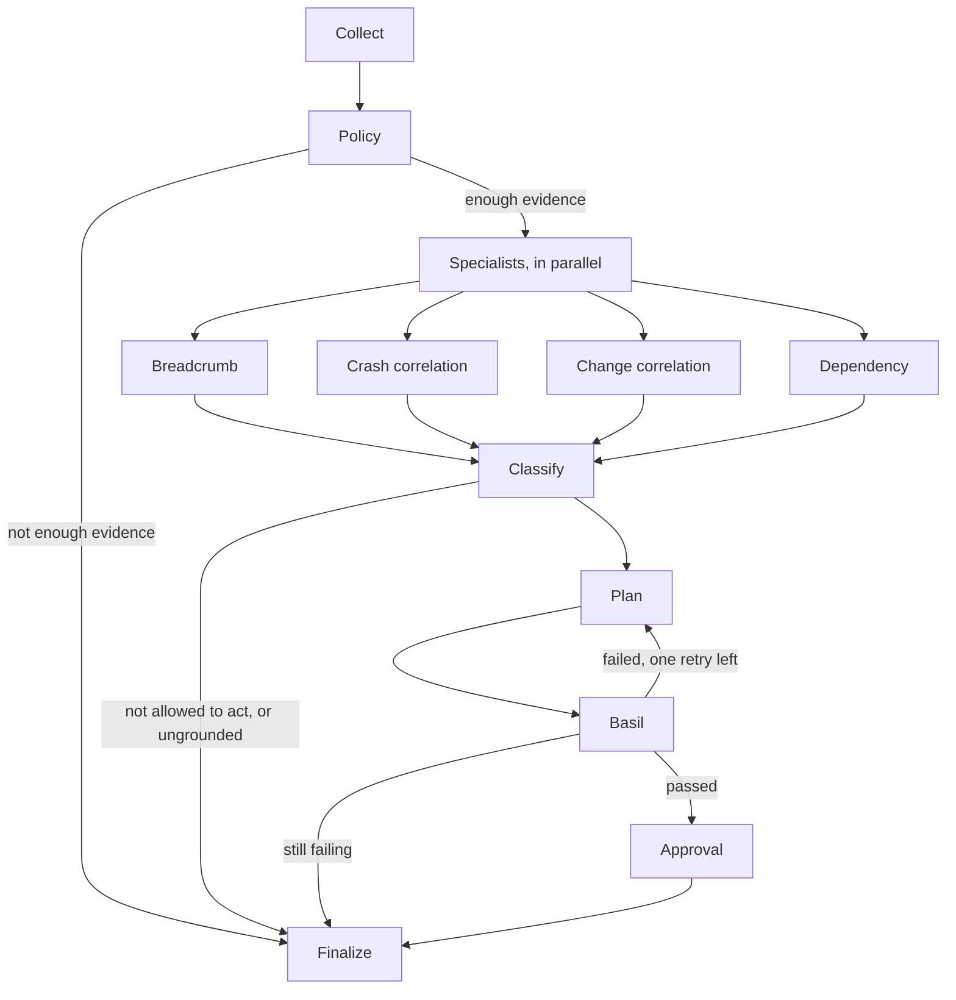

# Debugging agent

This is the architecture of an agentic debugging system. Each file is one box. Read them in order. The function bodies are stubs, so you can see the shape without a vendor, a model, or a sample incident.

An incident comes in. Evidence is gathered. A policy decides whether the agent may act. Several specialists read that evidence at the same time. Only then does a model choose a cause and propose a fix. A test run has to pass before a change is offered for review.

## Read in this order

1. [`debug_agent/graph.py`](debug_agent/graph.py) — the arrows. Start here.
2. [`debug_agent/state.py`](debug_agent/state.py) — what those arrows carry.
3. [`debug_agent/stages/collect.py`](debug_agent/stages/collect.py) — evidence in. No model.
4. [`debug_agent/connectors.py`](debug_agent/connectors.py) — Jaeger, logs, and flags plug in here, not on the graph.
5. [`debug_agent/stages/policy.py`](debug_agent/stages/policy.py) — whether the agent may change anything. This is code, not a prompt.
6. [`debug_agent/specialists.py`](debug_agent/specialists.py) — four readers, started together.
7. [`debug_agent/stages/classify.py`](debug_agent/stages/classify.py) — the model may only pick a claim a specialist already made.
8. [`debug_agent/stages/plan.py`](debug_agent/stages/plan.py) — the model proposes one mitigation.
9. [`debug_agent/stages/validate.py`](debug_agent/stages/validate.py) — Basil. A failure goes back to the planner.
10. [`debug_agent/stages/finalize.py`](debug_agent/stages/finalize.py) — a report, a review, or a handoff.

The arrows are a [LangGraph](https://langchain-ai.github.io/langgraph/). `python -m debug_agent` prints the same diagram from the code.
