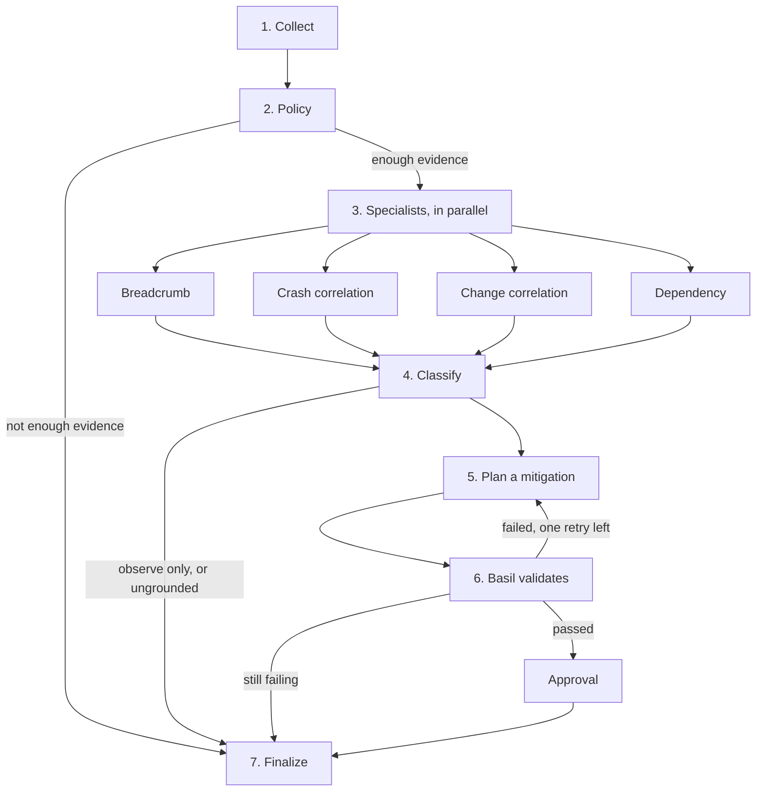

# debug-agent

A small, readable map of an agentic debugging system. The code is a skeleton you can run. Each box in the diagram is one module, with a stated input and a stated output. Vendor APIs and the language model are extension points, not the thing you have to understand first.

## The picture



Collection is deterministic. Specialists read evidence and return claims with fact ids. The model is only allowed to choose among those claims, then to propose a fix. Basil has to pass before a diff is offered to a person. A pull request is one possible ending, not the only one.

## Read the code in this order

| Order | File | What you learn |
| --- | --- | --- |
| 1 | [`debug_agent/graph.py`](debug_agent/graph.py) | The boxes and arrows. Start here. |
| 2 | [`debug_agent/state.py`](debug_agent/state.py) | The object passed along those arrows. |
| 3 | [`debug_agent/stages/collect.py`](debug_agent/stages/collect.py) | Load the incident, call connectors, redact secrets. |
| 4 | [`debug_agent/connectors.py`](debug_agent/connectors.py) | The slot where Jaeger, an MCP tool, or a fixture fits. |
| 5 | [`debug_agent/stages/policy.py`](debug_agent/stages/policy.py) | Who is allowed to edit what. This is code, not a prompt. |
| 6 | [`debug_agent/specialists.py`](debug_agent/specialists.py) | Four parallel readers. None of them decides the cause. |
| 7 | [`debug_agent/stages/classify.py`](debug_agent/stages/classify.py) | The model picks a hypothesis id, or the run stops. |
| 8 | [`debug_agent/stages/plan.py`](debug_agent/stages/plan.py) | First a reversible flag change, then a code edit. |
| 9 | [`debug_agent/stages/validate.py`](debug_agent/stages/validate.py) | The Basil box. A failure goes back to the planner. |
| 10 | [`debug_agent/stages/finalize.py`](debug_agent/stages/finalize.py) | Report, draft review, or escalation. |

[`ARCHITECTURE.md`](ARCHITECTURE.md) is the short note on why the pipeline is shaped this way instead of as one prompt.

## Run the sample

The sample is [`examples/checkout_async_capture.json`](examples/checkout_async_capture.json). Checkout starts timing out after the flag `checkout.async_capture` ramps to 100. The async path forwards an empty idempotency key.

```bash
pip install -e ".[dev]"
python -m debug_agent
python -m debug_agent graph
pytest
```

You should see two validation attempts. The flag ramp fails the stand-in Basil check, because a test that holds the flag on still demands a key. The code edit passes. Policy is `propose` (production payments), so the ending is `draft_pr`. The writeup is `runs/checkout_async_capture/report.md`.

The model in that run is `scripted_choice` in `stages/classify.py` and `scripted_plan` in `stages/plan.py`. They return the JSON a live model would return. The checks around them are the part to keep when you replace them.

## Where a real system plugs in

| You have | You change |
| --- | --- |
| Jaeger, Tempo, Honeycomb, or an MCP trace tool | A class like `JaegerConnector` in `connectors.py`. Register it. Do not edit a specialist. |
| LaunchDarkly, Unleash, or a flag MCP tool | A class like `FlagConnector`. Same evidence shape as the fixture. |
| A language model | Replace `scripted_choice` and `scripted_plan`. Keep `accept_classification`. |
| BASIL or another test runner | Replace the body of `basil_check`. Keep the result keys, including the tmt fields. |
| Another way of looking at an incident | Add a function in `specialists.py` and one line in `SPECIALISTS` in `graph.py`. |

Connectors normalize. Specialists cite facts. The model does not see raw vendor payloads, and it does not get to invent a fact id. That split is the whole design.

## What this skeleton does not do

It does not call Jaeger, a model provider, or a BASIL server. It does not edit a repository or open a pull request. Those are named extension points so the control flow stays visible.
